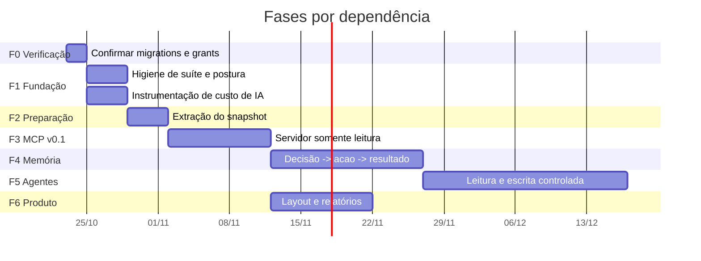
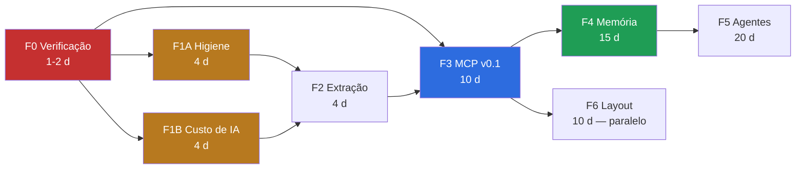

# Mugô Dados — Roadmap de evolução

**Base:** `badcb97` (`origin/main`)
**Baseline de testes medida nesta auditoria:** backend **1682 testes, 3 falhas conhecidas, 1 erro de ambiente** (`pypdf`); frontend **748/748 passando**.

Toda fase tem critério de aceite verificável. **[S]** marca estimativa; as demais afirmações são fatos da auditoria.

---

## Princípio de ordenação

As fases estão ordenadas por **dependência de risco**, não por valor percebido.

Três regras ditaram a ordem:

1. **Nada que amplie acesso a dados entra antes de confirmar o fechamento já escrito.** O MCP multiplica os caminhos de leitura de dados de tenant. Fazer isso antes de saber se as migrations 038/042 estão em vigor é a ordem errada.
2. **Nada que gaste IA entra antes de medir o gasto de IA.** **[F]** Hoje não há nenhuma instrumentação de token ou custo. Lançar agentes sobre um sistema que não mede consumo é como operar sem contabilidade.
3. **Nada de agente autônomo nesta janela.** Restrição explícita do briefing, e correta.

---

## Visão geral

**F6 não depende de F4 nem F5** e pode correr em paralelo a partir do fim de F3, com equipe distinta (direção de arte).

---

## Fase 0 — Verificação. **Antes de qualquer código**

**[S] 1–2 dias.** Depende de acesso ao banco, não de desenvolvimento.

### Por que é a fase 0

**[F]** Três migrations têm estado de aplicação desconhecido ou declaradamente pendente:

- `20261002_000038_browser_credential_lockdown.sql` — `-- MIGRATION LOCAL — revisar e aplicar remotamente só depois de validada.`
- `20261006_000042_ecommerce_browser_lockdown.sql` — `-- NÃO APLICADA. Criada nesta rodada e deixada pendente de propósito.`
- `20261022_000044_order_attribution.sql` — estado desconhecido (PR #14).

**[F]** E 4 tabelas sem RLS não são cobertas por nenhuma das duas migrations de fechamento: `cron_job_runs`, `cron_locks`, `fbits_order_daily_stats`, `meta_token_events`.

A correção do risco principal **já está escrita**. Não saber se está em vigor é o maior risco não quantificado do sistema.

### Tarefas

| # | Tarefa | Escrita? |
|---|---|---|
| 0.1 | Rodar a consulta de RLS/grants de `MUGO_DADOS_AUDIT.md` §11 | não |
| 0.2 | Verificar colunas de atribuição em `fbits_orders` (migration 044) | não |
| 0.3 | Aplicar 038 e 042, se pendentes — **com aprovação explícita** | **sim** |
| 0.4 | Decidir sobre as 4 tabelas descobertas: fechar ou justificar por escrito | **sim**, se fechar |
| 0.5 | Registrar o estado verificado neste repositório | não |

### Critério de aceite

- Tabela de `rls_ativo` / `anon_select` / `auth_select` para as 15 tabelas, anexada ao repositório.
- Nenhuma linha com `rls_ativo = false` **e** `auth_select = true` sem justificativa escrita.
- `ai_analyses` com `anon_select = false` — controle que confirma que a migration 021 está aplicada. Se vier `true`, o diagnóstico muda de escala e F0 se alonga.
- Estado da migration 044 conhecido.

### Risco

Aplicar 038/042 muda grants em produção. **[F]** Mitigação já embutida: as duas são idempotentes, usam `to_regclass` para tolerar tabela ausente, e a 042 documenta explicitamente que o backend usa `service_role` e recebe `grant` ali mesmo — nenhum dado apagado, nenhuma coluna alterada, nenhum KPI recalculado.

**Validação pós-aplicação:** suíte completa (esperado: 1682/3/1) e um smoke no painel. Se algo do browser quebrar, é porque dependia de um grant que não deveria existir — e aí o achado é ainda mais relevante.

---

## Fase 1 — Fundação. Higiene e medição

**[S] 4 dias.** Depende de F0. **Duas trilhas paralelas.**

### Trilha 1A — Higiene da suíte e de postura

| # | Tarefa | Evidência |
|---|---|---|
| 1.1 | **Triar as 4 rotas de conversa.** Decidir: viewer pode gerir as próprias conversas? Se sim, `EXEMPT` com motivo escrito; se não, trocar `_context` por `require_client_role`. | **[F]** `routes/intelligence.py:271-320` usam `_context` (`:31-39`), que valida membership e não papel |
| 1.2 | **Resolver as 2 falhas de `test_progressive_context`.** `AssertionError: 6 != 5` — o código faz 6 consultas onde o teste espera 5. Decidir qual está certo. | **[F]** execução |
| 1.3 | **Unificar a convenção de import dos testes.** 7 módulos usam `from server.services`; os demais `from services`. | **[F]** rodar de `server/` perde **154 testes**, incluindo `test_tenant_isolation` e `test_oauth_security` |
| 1.4 | **Trocar a lista literal por varredura** em `test_viewer_release_readiness.modules()`. | **[F]** `:188-199`; `sales_origin` ficou fora |
| 1.5 | **Inverter o default de `APP_ENV`:** ausência = produção. | **[F]** `render.yaml:17-18` define só no serviço web; 13 crons sem ele |
| 1.6 | **Declarar `pypdf`** em requirements de teste. | **[F]** importado em `test_intelligence_reports.py:7`, ausente de `requirements.txt` |
| 1.7 | **Remover o `sb_rpc` morto.** | **[F]** `ig_supabase.py:252` sobrescrito por `:263` |

**1.1 e 1.2 são a tarefa mais valiosa da fase**, e não por mérito técnico: **enquanto a suíte é verde-com-ressalvas, nenhuma falha nova é notada.** Uma suíte cronicamente vermelha custa mais que os três defeitos que ela aponta.

**Critério de aceite 1A:** `python3 -m unittest discover -s server/tests -p 'test_*.py'` → **0 falhas, 0 erros, ≥1682 testes**. O mesmo resultado rodando de `server/` e da raiz. `npm test` verde.

### Trilha 1B — Instrumentação de custo de IA

| # | Tarefa |
|---|---|
| 1.8 | Capturar `usage` da resposta da OpenAI e persistir em `ai_analyses` (colunas novas: `prompt_tokens`, `completion_tokens`, `cost_usd`, `latency_ms`) |
| 1.9 | Registrar o mesmo para a rota `/ask` |
| 1.10 | Consulta de custo por empresa e por período |

**[F] Justificativa:** `grep -niE "prompt_tokens|completion_tokens|total_tokens|usage|cost_"` em `intelligence.py` → **zero ocorrências**. `ai_analyses` grava `provider` e `model`, nenhum consumo. **[F]** O modelo é `gpt-4.1-mini` (`intelligence.py:2192`), chamado pela Responses API via httpx cru — o campo `usage` vem na resposta e hoje é descartado.

**Isto é pré-requisito comercial, não refinamento.** Sem custo por empresa não há como precificar o SaaS, nem como detectar um cliente que consome desproporcionalmente.

**Critério de aceite 1B:** gerar uma análise e obter, por consulta, tokens, custo e latência atribuídos àquela empresa.

**[F] Regra de log a respeitar:** `intelligence.py:2185-2190` loga só o código do erro, com o comentário *"Só o código: o valor da variável nunca entra no log"*. A instrumentação registra **números**, nunca conteúdo de prompt ou resposta.

---

## Fase 2 — Preparação do MCP

**[S] 4 dias.** Depende de F1 (a rede de teste precisa estar verde).

| # | Tarefa |
|---|---|
| 2.1 | Criar `server/services/intelligence_snapshot_core.py` com `collect_overview()` e `compare()` |
| 2.2 | Fazer `calculate_intelligence_snapshot` chamar as funções extraídas |
| 2.3 | Testes de equivalência: mesma entrada, mesma saída |

**[F] Justificativa:** `calculate_intelligence_snapshot` vai de `intelligence.py:861` a ≈`:2321` — cerca de **1460 linhas numa função** — e é a fonte de `get_business_overview` e `compare_periods`. A comparação de período já existe em `:762-770` (`previous_period`).

**Esta é a única refatoração que o MCP v0.1 exige.** Não é embelezamento: chamar a função inteira do MCP traria o snapshot completo (mídia, contexto de negócio) para responder uma leitura de métricas — custo e latência desproporcionais.

**Critério de aceite:** comportamento observável idêntico, provado pela suíte de F1 continuando verde. Nenhum teste novo falhando, nenhum teste existente alterado para acomodar a extração.

**Risco:** mexer no coração do motor. Mitigação: **[F]** há 1682 testes de backend, e a extração é mecânica (mover código, não redesenhar). Se a suíte de F1 não estiver verde, **F2 não começa** — sem rede, a extração é imprudente.

---

## Fase 3 — MCP v0.1 somente leitura

**[S] 10 dias.** Depende de F0 e F2. Detalhado em `MUGO_MCP_IMPLEMENTATION_PLAN.md`.

| # | Entrega |
|---|---|
| 3.1 | Migration `mcp_tokens` (hash, `client_id`, `user_id`, escopos, expiração, revogação) |
| 3.2 | Emissão e revogação de token pelo painel, com `require_client_read` / `require_client_manage` |
| 3.3 | Servidor MCP em Streamable HTTP, serviço separado no Render |
| 3.4 | 4 ferramentas somente leitura |
| 3.5 | Rate limit persistido e instrumentação de uso |
| 3.6 | Testes negativos de acesso cruzado e de isolamento estrutural |

**Critério de aceite:**

- Token da empresa A **não** devolve nenhum dado da empresa B. Teste negativo explícito.
- **Nenhuma ferramenta aceita `client_id`** — verificado por varredura dos schemas.
- Membership revogada invalida token vivo na chamada seguinte.
- Nenhum módulo MCP importa `ig_supabase` — verificado por AST.
- Nenhuma ferramenta de escrita registrada.
- Uso contabilizado por empresa e por ferramenta.
- Suíte de F1 continua verde.

**[F] Risco específico:** `agency_admin` alcança qualquer empresa (`tenant.py:41-48`, `:63-79`). Mitigação arquitetural: **uma empresa por token**, nunca a carteira.

---

## Fase 4 — Memória estratégica

**[S] 15 dias.** Depende de F3. Detalhado em `MUGO_INTELLIGENCE_MEMORY.md`.

| # | Entrega |
|---|---|
| 4.1 | 4 tabelas com RLS **e** revoke, no padrão das migrations 038/042 |
| 4.2 | Serviço `strategic_memory.py` com guards |
| 4.3 | Extração de recomendações do jsonb de `ai_analyses` |
| 4.4 | Registro de decisão: aceitar / recusar / adiar, com motivo |
| 4.5 | Registro de ação e resultado, com `confounders` |
| 4.6 | Injeção de memória no contexto da IA — **recusas primeiro** |
| 4.7 | Incluir as 4 tabelas em `delete_platform_company` |

**Critério de aceite:** a pergunta *"Quais recomendações aplicamos na Roove nos últimos três meses e quais resultados foram observados?"* respondida por um `SELECT` com `JOIN`, sem inferência.

**Caminho mínimo com valor (≈5,5 dias):** 4.1 + 4.2 + 4.3 + 4.6, sem UI. Já encerra a repetição de recomendações recusadas — **[S]** provavelmente o ganho de qualidade mais perceptível de todo o roadmap, pelo menor custo.

**[F] Atenção a 4.7:** a migration 036 criou `delete_platform_company`; tabelas novas não entram automaticamente. Exclusão incompleta de empresa é risco de LGPD, e é o item mais fácil de esquecer do roadmap.

---

## Fase 5 — Agentes com escrita controlada

**[S] 20 dias.** Depende de F4. **Não há agente autônomo em produção nesta fase** — restrição do briefing.

### Separação de níveis, exigida pelo briefing

| Nível | Exemplo | Autorização |
|---|---|---|
| **Leitura** | consultar métricas, histórico, memória | token MCP com escopo de leitura |
| **Escrita controlada** | criar tarefa, registrar recomendação ou hipótese | escopo de escrita + `idempotency_key` + auditoria |
| **Ação sensível** | alterar orçamento ou campanha, dado financeiro, configuração externa | **confirmação humana obrigatória** + `authorization_ref` + auditoria |

### Entregas

| # | Entrega |
|---|---|
| 5.1 | Escopos de escrita no token, desligados por padrão |
| 5.2 | Idempotência: `idempotency_key` obrigatória, chave e resultado persistidos |
| 5.3 | Fila de aprovação humana para ação sensível |
| 5.4 | Ferramentas de escrita restritas a tabelas **internas** da Mugô (memória, tarefas) |
| 5.5 | Detecção de anomalia como **leitura** que propõe, nunca executa |
| 5.6 | Integração com o CRM próprio da Mugô |

**Decisão de desenho que vale registrar:** nenhuma ferramenta de agente escreve em plataforma externa (Meta, Google) nesta fase. Escrita externa é irreversível, cara e, **[F]** dado que nomes de campanha são superfície de injeção, perigosa. Agente propõe; humano aplica no painel da plataforma.

**Critério de aceite:** nenhuma ação sensível executável sem registro de confirmação humana; repetição de chamada com a mesma `idempotency_key` não duplica efeito.

---

## Fase 6 — Produto: layout e relatórios

**[S] 10 dias.** Em paralelo a F4/F5, com equipe distinta. Depende apenas de F3 ter estabilizado.

| # | Entrega |
|---|---|
| 6.1 | Separar apresentação de orquestração de dados em `Intelligence.tsx` |
| 6.2 | Aplicar o layout da direção de arte **sem tocar cálculo, regra de negócio ou segurança** |
| 6.3 | Verificar paridade entre exibido e exportado em PDF |
| 6.4 | Revisar estados de vazio, carregamento e erro |

**[F] Justificativa de 6.1:** `src/pages/Intelligence.tsx` tem **1196 linhas**. Aplicar layout sobre um componente desse tamanho significa tocar, no mesmo arquivo, lógica de período, cobertura e chamada de API. A separação **precede** a entrega visual, ou a troca de layout vira risco funcional.

**[F] 6.3 é dívida de homologação real:** o módulo que testa o PDF não executa — `test_intelligence_reports.py:7` importa `pypdf`, ausente de `requirements.txt`. Resolvido em 1.6, verificado aqui.

**Critério de aceite:** nenhuma alteração em `server/services/` dentro desta fase. Suíte de frontend verde (baseline: 748/748). Paridade exibido/exportado coberta por teste que **executa**.

---

## Dependências

**Dependências estritas, e a razão de cada uma:**

| Dependência | Razão |
|---|---|
| F1 → F2 | extrair 1460 linhas sem suíte verde é imprudente |
| F0 → F3 | não ampliar caminhos de leitura antes de confirmar o fechamento de grants |
| F1B → F3 | **[F]** o MCP multiplica chamadas; sem medição de custo, o gasto fica invisível |
| F3 → F4 | a memória é exposta via MCP; definir o contrato antes de povoar |
| F4 → F5 | agente sem memória de decisão repete recomendação recusada |
| F3 → F6 | layout sobre contrato de dados estável |

---

## Esforço consolidado

**[S] Estimativas.** Dias de uma pessoa desenvolvedora.

| Fase | Esforço | Acumulado |
|---|---|---|
| F0 Verificação | 1–2 d | 2 d |
| F1 Fundação (1A + 1B em paralelo) | 4 d | 6 d |
| F2 Extração | 4 d | 10 d |
| F3 MCP v0.1 | 10 d | 20 d |
| F4 Memória | 15 d | 35 d |
| F5 Agentes | 20 d | 55 d |
| F6 Layout (paralelo) | 10 d | — |

**≈55 dias úteis** até o fim de F5, com F6 em paralelo. **≈20 dias** até MCP v0.1 em produção.

**Marco de maior valor por esforço: F0 + F1, em ≈6 dias.** Fecha os dois riscos Altos, zera a suíte e habilita precificação. Nenhuma linha de MCP escrita, e o sistema fica substancialmente mais sólido.

---

## O que este roadmap recusa fazer

| Recusa | Razão |
|---|---|
| Reescrever `intelligence.py` | **[F]** 1682 testes dependem do comportamento atual; uma extração pontual resolve o MCP |
| Substituir a camada de autorização | **[F]** `resolve_client_id` já satisfaz o requisito mais difícil do briefing |
| Trocar `service_role` por RLS na API | mudança de fundação com ganho marginal: os guards aplicacionais já isolam e estão testados |
| Adotar embeddings | volume não justifica; a pergunta de memória é estruturada |
| Agente autônomo em produção | restrição do briefing, e correta sem F4 |
| Escrita em plataforma externa por agente | irreversível, caro, e exposto a injeção via nome de campanha |
| OAuth no MCP v0.1 | desproporcional para uma população de clientes conhecida |
| Instalar dependência além do SDK MCP | o `requirements.txt` tem 8 pacotes + `reportlab`; manter enxuto |

---

## Riscos do roadmap

| Risco | Probabilidade | Mitigação |
|---|---|---|
| F0 revela que 038/042 nunca foram aplicadas e algo do browser dependia do grant | **[S]** média | as migrations são idempotentes e documentam que o backend usa `service_role`; validar com suíte + smoke |
| F2 quebra o motor de inteligência | **[S]** média | extração mecânica sob 1682 testes; **não iniciar sem F1 verde** |
| As 3 falhas conhecidas de F1 revelam defeito real, não teste desatualizado | **[S]** média | é justamente o que a triagem precisa descobrir; pode alongar F1 |
| MCP vaza dado entre empresas | **[S]** baixa | token de uma empresa + nenhuma ferramenta aceita `client_id` + testes negativos |
| Custo de IA explode com agentes | **[S]** média | F1B precede F3 por este motivo |
| Memória vira narrativa de sucesso | **[S]** média | `assessment = 'inconclusive'` e `confounders` obrigatórios; medição não automatizada |
| Layout de F6 toca cálculo | **[S]** baixa | 6.1 separa antes; critério de aceite proíbe alteração em `server/services/` |
| Grafo graphify desatualizado desorienta quem explora o código | **[S]** alta | **[F]** o grafo não contém o PR #14; rodar `graphify update .` ao fim de cada fase, como `CLAUDE.md` já exige |

---

## Pendência aberta, fora do roadmap

**[F]** A investigação de origem das vendas da Curavino está parada aguardando a saída de `fbits-origin-probe`. O passo 4 daquela investigação — confirmar se `fbits_orders.utm_source` existe — **é a tarefa 0.2 deste roadmap**. As duas se resolvem na mesma verificação.
