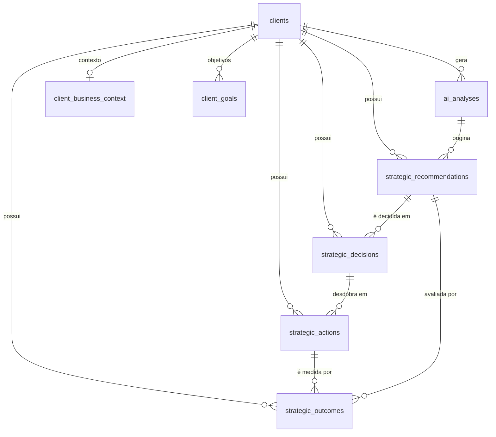
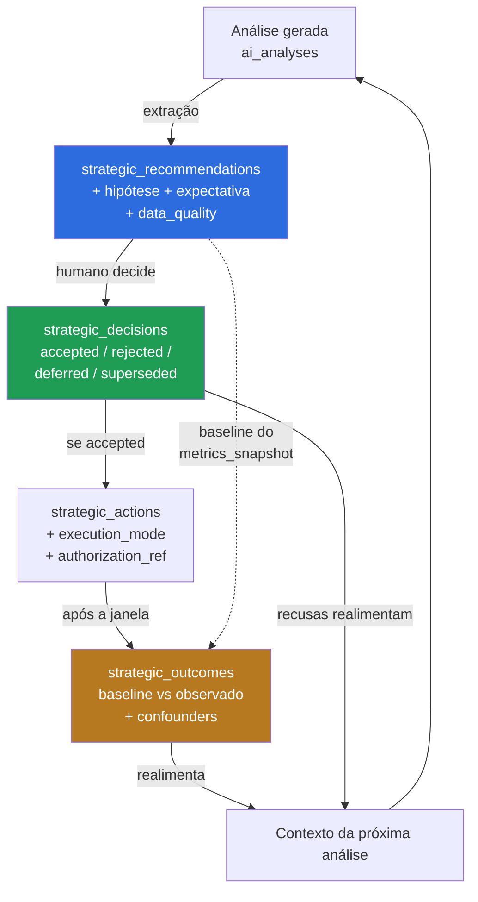

# Memória estratégica por empresa

**Base de código:** `badcb97` (`origin/main`)
**Status:** proposta. Nenhuma migration executada.

---

## 1. O problema, enunciado com precisão

A pergunta de referência do briefing:

> *"Quais recomendações aplicamos na Roove nos últimos três meses e quais resultados foram observados?"*

**[F] Hoje essa pergunta não é respondível.** Não por falta de dados, mas por uma distinção que o schema atual não faz.

O sistema registra **o que a IA analisou**. A pergunta é sobre **o que a agência decidiu e no que deu**.

| O que existe | O que a pergunta exige |
|---|---|
| `ai_analyses.analysis` — jsonb com as recomendações de uma geração | recomendações com identidade, enumeráveis, filtráveis por período |
| — | registro de quais foram **aceitas** e quais **descartadas** |
| — | registro do que foi **executado**, por quem, quando |
| — | **resultado observado** depois da execução |

**[F]** Verificado: nenhuma tabela de decisão, ação, recomendação, hipótese ou resultado existe nas 44 migrations. As recomendações vivem exclusivamente dentro de `ai_analyses.analysis` (jsonb) — sem id próprio, sem como listar, sem como ligar a um desfecho.

A consequência prática é que **o sistema não aprende**. Cada análise parte do zero e reencontra as mesmas conclusões, sem saber que a recomendação de agosto foi aplicada e fracassou, ou aplicada e funcionou.

---

## 2. O que já existe e deve ser reusado

**[F]** O substrato é maior do que parece. Não se começa do zero.

| Necessidade do briefing | Onde já está | Estado |
|---|---|---|
| Contexto do negócio | `client_business_context` — `segment`, `product_description`, `audience`, `positioning`, `differentiators`, `commercial_context`, `goals`, `strategic_notes` | **Pronto** |
| Objetivos | `client_goals` — `metric`, `label`, `target_value`, `period_start/end`, `created_by` | **Pronto** |
| Indicadores relevantes | `dashboard_daily_metrics` e read models `dashboard_*` | **Pronto** |
| Campanhas | `campaign_daily_stats`, `ad_daily_stats`, `promoted_post_daily_stats` | **Pronto** |
| Evidências e fontes | `ai_analyses.sources`, `.data_quality`, `.metrics_snapshot`, `.context_fingerprint` | **Pronto** |
| Datas | `created_at` / `completed_at` em toda tabela relevante | **Pronto** |
| Responsáveis | `ai_analyses.requested_by` → `auth.users`; `client_goals.created_by` | **Parcial** |
| Recomendações da IA | dentro de `ai_analyses.analysis` (jsonb) | **Não consultável** |
| Hipóteses | — | **Ausente** |
| Decisões humanas | — | **Ausente** |
| Ações executadas | — | **Ausente** |
| Resultados observados | — | **Ausente** |

**[F] Ativo de altíssimo valor, e é o que torna esta proposta viável:** `ai_analyses` já guarda `metrics_snapshot` — **o estado das métricas no momento da análise**. Isso significa que a linha de base de qualquer recomendação **já está preservada**, sem trabalho adicional. Medir resultado é comparar o snapshot de então com o período de agora. O dado mais difícil de obter retroativamente já é coletado.

**[F]** `context_fingerprint` (`intelligence.py:2321-2376`) dá, de graça, a capacidade de saber se duas análises partiram do mesmo contexto — útil para distinguir "a recomendação mudou porque o negócio mudou" de "a recomendação mudou porque o modelo variou".

---

## 3. Decisão: PostgreSQL relacional, sem embeddings na v1

O briefing pede que se avalie Postgres, busca textual e embeddings. A avaliação:

### Embeddings: **não na v1**, e o motivo é concreto

Argumento a favor seria a busca semântica sobre o histórico. Contra, três fatos:

1. **O volume não justifica.** **[S]** Uma agência com dezenas de clientes e análises mensais produz centenas de recomendações por ano, não milhões. Em centenas de linhas, `WHERE client_id = ... AND created_at > ...` com índice é mais rápido e infinitamente mais auditável que uma busca por similaridade.
2. **A pergunta de referência é estruturada, não semântica.** "Quais recomendações aplicamos nos últimos três meses e quais resultados" é `JOIN` + filtro de data + agregação. Embedding não ajuda; atrapalha, porque introduz recall aproximado onde se quer resposta exata.
3. **Similaridade aproximada é um risco de alucinação.** **[F]** O motor atual recusa combinar duas fontes de comércio em vez de adivinhar (`intelligence_tools.py:95-97`). Trazer "a recomendação mais parecida" para um contexto de IA contradiz essa disciplina: o modelo receberia algo *próximo* como se fosse *o* registro.

**[F]** Hoje não há pgvector: `grep -rli "vector|embedding" supabase/migrations/` → 0 arquivos.

**Quando reconsiderar.** Quando houver busca em texto livre sobre `strategic_notes` e descrições acumuladas em volume que torne o `ILIKE` insatisfatório. Gatilho objetivo: mais de ~5 000 recomendações registradas, ou demanda explícita de busca por tema. **Antes disso, `tsvector` com dicionário português resolve** — nativo no Postgres, sem extensão, sem custo de embedding, sem dependência de provedor.

### Treinamento de modelo próprio: **não**, e o briefing pede justificativa

Não se justifica, por três razões:

1. **O problema não é de capacidade do modelo, é de dado ausente.** Nenhum treinamento inventa o registro de decisões que não foi feito.
2. **O volume é ordens de magnitude abaixo** do necessário para fine-tuning útil.
3. **Contexto estruturado resolve.** **[F]** O padrão existente — injetar fatos verificados com `status` e `limitations` — já produz respostas fundamentadas com `gpt-4.1-mini` (`intelligence.py:2192`). Mais dado estruturado no contexto supera um modelo ajustado com dado escasso, e permanece auditável.

---

## 4. Modelo de dados proposto

Quatro tabelas novas. O eixo é o **ciclo de decisão**, não o armazenamento de texto.



O desenho separa quatro coisas que hoje se confundem:

- **Recomendação** — o que a IA propôs. Imutável.
- **Decisão** — o que o humano resolveu sobre ela. Inclui a recusa, que é informação valiosa.
- **Ação** — o que efetivamente se fez. Pode não existir, mesmo havendo decisão de aceitar.
- **Resultado** — o que se observou depois. Pode ser inconclusivo, e isso precisa ser dizível.

### 4.1 `strategic_recommendations`

Extrai do jsonb o que precisa ser consultável. **A análise original não é alterada** — `ai_analyses.analysis` continua a fonte de verdade do texto; esta tabela é o índice navegável.

```sql
create table if not exists public.strategic_recommendations (
  id uuid primary key default gen_random_uuid(),
  client_id text not null references public.clients(id) on delete cascade,
  analysis_id uuid references public.ai_analyses(id) on delete set null,

  title text not null,
  rationale text,
  -- Classificação fechada: nada aberto que o modelo possa inventar.
  category text not null check (category in (
    'investimento','criativo','publico','canal','produto',
    'preco','operacao','dados','outro'
  )),
  -- Hipótese explícita: o que se espera que aconteça, e por quê.
  hypothesis text,
  expected_metric text,
  expected_direction text check (expected_direction in ('increase','decrease','maintain')),

  -- Evidência que sustentava a recomendação, no momento em que foi feita.
  evidence jsonb not null default '[]'::jsonb,
  metric_ids jsonb not null default '[]'::jsonb,
  period_start date,
  period_end date,
  -- Cobertura dos dados que a originaram. Uma recomendação nascida de
  -- cobertura parcial não deve ser lida depois como se fosse certeza.
  data_quality jsonb not null default '{}'::jsonb,

  source text not null default 'ai' check (source in ('ai','human')),
  created_at timestamptz not null default now()
);

create index if not exists strategic_recommendations_client_created_idx
  on public.strategic_recommendations(client_id, created_at desc);
create index if not exists strategic_recommendations_analysis_idx
  on public.strategic_recommendations(analysis_id);
```

**`hypothesis`, `expected_metric` e `expected_direction` são o coração da tabela.** Sem eles não há como avaliar resultado: uma recomendação sem expectativa declarada não pode ser julgada depois, só racionalizada. Declarar a expectativa *antes* é o que impede a leitura retroativa conveniente.

**`data_quality` carrega a honestidade para a frente.** **[F]** O motor atual já marca cobertura parcial com *"valores observados não certificam o total do período"* (`intelligence_tools.py:127`). Essa ressalva precisa viajar com a recomendação, ou em três meses ninguém lembra que ela nasceu de dado incompleto.

### 4.2 `strategic_decisions`

```sql
create table if not exists public.strategic_decisions (
  id uuid primary key default gen_random_uuid(),
  client_id text not null references public.clients(id) on delete cascade,
  recommendation_id uuid references public.strategic_recommendations(id) on delete set null,

  decision text not null check (decision in (
    'accepted','rejected','deferred','superseded'
  )),
  rationale text,
  -- Quem decidiu. Humano, sempre: a IA recomenda, não decide.
  decided_by uuid not null references auth.users(id) on delete restrict,
  decided_at timestamptz not null default now(),
  review_at date,
  created_at timestamptz not null default now()
);

create index if not exists strategic_decisions_client_decided_idx
  on public.strategic_decisions(client_id, decided_at desc);
create index if not exists strategic_decisions_recommendation_idx
  on public.strategic_decisions(recommendation_id);
```

**`rejected` é tão importante quanto `accepted`.** Saber que uma recomendação foi recusada três vezes, e por quê, evita que a IA a proponha pela quarta. **[S]** É provavelmente o ganho de qualidade mais rápido de toda esta proposta: o custo é um campo de texto, e o efeito é o fim da repetição.

**`decided_by` é `not null` e aponta para `auth.users`.** Decisão sem responsável não é decisão. `on delete restrict` preserva o histórico: um usuário removido não apaga o registro de que decidiu.

### 4.3 `strategic_actions`

```sql
create table if not exists public.strategic_actions (
  id uuid primary key default gen_random_uuid(),
  client_id text not null references public.clients(id) on delete cascade,
  decision_id uuid references public.strategic_decisions(id) on delete set null,

  description text not null,
  status text not null default 'planned' check (status in (
    'planned','in_progress','done','cancelled'
  )),
  executed_by uuid references auth.users(id) on delete set null,
  -- Quando a execução é feita por automação, e não por pessoa.
  executed_by_agent text,
  -- Separação exigida pelo briefing: leitura / escrita controlada / sensível.
  execution_mode text not null default 'manual' check (execution_mode in (
    'manual','agent_assisted','agent_automatic'
  )),
  -- Trilha de auditoria para ação executada por automação.
  authorization_ref text,
  started_at timestamptz,
  completed_at timestamptz,
  created_at timestamptz not null default now()
);

create index if not exists strategic_actions_client_status_idx
  on public.strategic_actions(client_id, status, created_at desc);
```

**`execution_mode` e `authorization_ref` existem desde já**, embora a v1 só registre ação manual. Razão: quando os agentes chegarem (fase 5 do roadmap), a trilha de auditoria precisa estar no schema **antes**, não ser retro-encaixada. Uma ação sensível executada por agente sem `authorization_ref` fica detectável por consulta.

### 4.4 `strategic_outcomes`

```sql
create table if not exists public.strategic_outcomes (
  id uuid primary key default gen_random_uuid(),
  client_id text not null references public.clients(id) on delete cascade,
  recommendation_id uuid references public.strategic_recommendations(id) on delete set null,
  action_id uuid references public.strategic_actions(id) on delete set null,

  -- Janela de medição. Explícita, nunca inferida.
  measured_period_start date not null,
  measured_period_end date not null,

  metric text not null,
  baseline_value numeric,
  observed_value numeric,
  variation_percent numeric,

  -- 'inconclusive' é um resultado legítimo e precisa ser dizível.
  assessment text not null check (assessment in (
    'positive','negative','neutral','inconclusive'
  )),
  -- Por que pode ser inconclusivo: cobertura, prazo, confusão com outra ação.
  assessment_reason text,
  -- Cobertura real dos dados que sustentam ESTA medição.
  data_quality jsonb not null default '{}'::jsonb,
  -- Outras ações ativas na mesma janela: limite honesto de atribuição.
  confounders jsonb not null default '[]'::jsonb,

  recorded_by uuid references auth.users(id) on delete set null,
  recorded_at timestamptz not null default now()
);

create index if not exists strategic_outcomes_client_recorded_idx
  on public.strategic_outcomes(client_id, recorded_at desc);
create index if not exists strategic_outcomes_recommendation_idx
  on public.strategic_outcomes(recommendation_id);
```

**Os dois campos que impedem esta tabela de virar máquina de narrativa falsa:**

- **`assessment = 'inconclusive'`** com `assessment_reason`. Sem essa opção, toda medição é forçada a positivo, negativo ou neutro, e a pressão natural empurra para "positivo". **[F]** É o mesmo princípio do `status: unavailable` que o motor já usa em vez de devolver zero (`intelligence_tools.py:163`).
- **`confounders`.** Se três ações rodaram na mesma janela, a receita subiu, mas **não se sabe por qual**. Registrar as concorrentes é o que separa medição de atribuição indevida.

**[F]** Isto é coerente com a regra de atribuição que o projeto já adotou em `order_attribution.py`: *"Venda sem origem nunca é distribuída entre campanhas."* O mesmo rigor aqui: **resultado com confundidores não é creditado a uma única ação.**

### 4.5 `baseline_value` vem de graça

**[F]** `ai_analyses.metrics_snapshot` guarda o estado das métricas no momento da análise. Como `strategic_recommendations.analysis_id` aponta para lá, o `baseline_value` de um outcome é **recuperável do snapshot original**, sem necessidade de ter sido capturado na hora da decisão.

Isso tem uma consequência prática relevante: **o histórico já existente é parcialmente recuperável.** Recomendações passadas, hoje presas no jsonb, podem ser extraídas com a linha de base correta.

---

## 5. Isolamento por empresa

### 5.1 RLS obrigatória nas quatro tabelas

**[F]** A auditoria encontrou 13 tabelas criadas sem RLS, e documentou o mecanismo exato do risco (migration 042): *"O privilégio de tabela é verificado ANTES da RLS"*, e objetos criados por `postgres`/`supabase_admin` recebem grant default para `anon` e `authenticated`.

As tabelas de memória contêm o material mais sensível do sistema — estratégia comercial, decisões internas, justificativas de recusa. Elas **nascem fechadas**, com RLS **e** revoke, seguindo o padrão das migrations 038 e 042:

```sql
do $$
declare
  t text;
begin
  foreach t in array array[
    'strategic_recommendations','strategic_decisions',
    'strategic_actions','strategic_outcomes'
  ]
  loop
    execute format('alter table public.%I enable row level security', t);
    -- O revoke é o que importa: sem privilégio de tabela, a policy nem
    -- é avaliada. RLS sozinha não basta, como a 042 demonstrou.
    execute format('revoke all on public.%I from anon, authenticated', t);
    execute format('grant all on public.%I to service_role', t);
  end loop;
end
$$;

notify pgrst, 'reload schema';
```

**Decisão: nenhum acesso do browser a estas tabelas.** Todo acesso passa pelo backend, que aplica `require_client_read` ou `require_client_manage`. Razão: a granularidade de papel que o backend aplica (um `viewer` não deve ler a justificativa de uma recusa de investimento) é **inexprimível** numa policy de RLS baseada só em membership.

**[F]** Este é exatamente o raciocínio da migration 042: *"um `viewer` lê pelo browser o mesmo payload bruto que o backend nunca entrega a ele — a granularidade de papel e a minimização de campos do backend são contornáveis."* Não repetir o erro em tabelas novas.

### 5.2 Autorização por operação

| Operação | Guard | Razão |
|---|---|---|
| Ler recomendações e resultados | `require_client_read` | qualquer membro acompanha |
| Ler `rationale` de decisão | `require_client_manage` | justificativa de recusa é material interno |
| Registrar decisão | `require_client_manage` | **[F]** mutação exige papel (`tenant.py:117-135`) |
| Registrar ação e resultado | `require_client_manage` | idem |
| Extrair recomendação de análise | `require_client_read` | derivação de dado já legível |

**[F]** Toda rota de mutação precisa constar do meta-teste `test_viewer_release_readiness::test_no_mutation_route_lacks_a_role_guard`. E a lista `modules()` (`:188-199`) deve passar a **descobrir** os módulos de `routes/` por varredura — a auditoria constatou que `sales_origin`, criado no PR #14, ficou fora da lista literal.

### 5.3 Defesa em profundidade

**[F]** Padrão estabelecido na casa (`intelligence_conversations.py:21-22`, `intelligence_tools.py:73` e `:149`): filtrar por `client_id` na consulta **e** reverificar as linhas devolvidas antes de retornar. As quatro tabelas seguem o mesmo padrão. Não é redundância ociosa: protege contra filtro malformado, que é o modo de falha real.

---

## 6. Recuperação de contexto

### 6.1 A pergunta de referência, resolvida

> *"Quais recomendações aplicamos na Roove nos últimos três meses e quais resultados foram observados?"*

```sql
select r.title,
       r.category,
       r.hypothesis,
       d.decision,
       d.decided_at,
       a.status        as acao,
       o.metric,
       o.baseline_value,
       o.observed_value,
       o.variation_percent,
       o.assessment,
       o.assessment_reason,
       jsonb_array_length(o.confounders) as concorrentes
from strategic_recommendations r
left join strategic_decisions d on d.recommendation_id = r.id
left join strategic_actions   a on a.decision_id       = d.id
left join strategic_outcomes  o on o.recommendation_id = r.id
where r.client_id = $1
  and d.decision = 'accepted'
  and d.decided_at >= now() - interval '3 months'
order by d.decided_at desc;
```

Um `SELECT` com `JOIN`. Sem embedding, sem busca aproximada, sem inferência. É a confirmação de que o problema era de modelagem, não de tecnologia.

**[F]** Note `concorrentes`: a consulta devolve, junto com o resultado, **quantas outras ações disputavam a mesma janela** — para que a resposta nunca credite sozinha o que foi disputado.

### 6.2 O que entra no contexto da IA

**[F]** Regra de ouro, derivada do padrão existente (`intelligence_tools.py:41-44`, `MAX_INPUT_CHARS = 14000`): a memória entra **resumida e marcada**, nunca em bruto.

Ao gerar uma análise nova, injetar:

| Item | Teto | Por quê |
|---|---|---|
| Contexto do negócio | 1 registro | `client_business_context`, já existe |
| Objetivos do período | até 10 | `client_goals`, já existe |
| Recomendações **aceitas** com resultado | 10 mais recentes | o que funcionou e o que não |
| Recomendações **recusadas** com motivo | 5 mais recentes | **evita repropor o já recusado** |
| Ações em andamento | todas `in_progress` | evita recomendar o que já está em curso |

**Três restrições não negociáveis:**

1. **Resultado `inconclusive` entra marcado como inconclusivo.** Nunca como sucesso ou fracasso. O modelo precisa ver a incerteza, não uma versão limpa dela.
2. **Resultado com `confounders` não vazio** entra com a ressalva explícita de que a atribuição é disputada.
3. **Texto de memória é dado, não instrução.** **[F]** `intelligence_tools.py:38`: *"Texto do usuário não é autorização."* Uma `rationale` ou `strategic_notes` é conteúdo escrito por humano e, uma vez no contexto, é superfície de injeção. Entra sob chave que a identifique como dado — jamais concatenada às instruções do sistema.

### 6.3 Exposição via MCP

`get_analysis_history` (ver `MUGO_MCP_ARCHITECTURE.md` §5.4) é a porta natural. Em fase posterior, uma ferramenta `get_strategic_memory` somente-leitura, com as mesmas regras: escopo pelo token, nunca por parâmetro; `rationale` de decisão **excluída** por padrão (exige papel de gestão, §5.2).

---

## 7. Retenção

| Tabela | Retenção | Razão |
|---|---|---|
| `strategic_recommendations` | indefinida | volume baixo; é o histórico de raciocínio |
| `strategic_decisions` | indefinida | registro de responsabilidade; `on delete restrict` em `decided_by` |
| `strategic_actions` | indefinida | trilha de auditoria |
| `strategic_outcomes` | indefinida | sem série longa não há aprendizado |
| `ai_messages` | **candidata a poda** | conversa é efêmera; o valor durável migra para recomendação |

**[S] Justificativa para retenção indefinida.** O volume é baixo — centenas de linhas por cliente por ano, texto curto. O custo de guardar é desprezível; o custo de apagar é perder a única série temporal de decisão que a agência tem. Memória estratégica que expira em 12 meses não responde "o que tentamos nos últimos três anos", que é precisamente a pergunta de maior valor comercial.

**Exclusão de empresa.** **[F]** Todas as quatro tabelas usam `references public.clients(id) on delete cascade`, alinhado ao que já existe (`ai_analyses`). **[F]** A migration 036 criou `delete_platform_company`, que remove dados de empresa — a função precisará contemplar as quatro tabelas novas, ou a exclusão fica incompleta. **Item explícito do roadmap, fácil de esquecer.**

**LGPD.** Estas tabelas guardam estratégia comercial e decisões internas, **não dados pessoais de consumidor** — exceto `decided_by` / `executed_by` / `recorded_by`, que identificam colaboradores da agência e do cliente. **Regra:** nunca gravar nome, e-mail, CPF, telefone ou endereço de consumidor final em `rationale`, `description` ou `assessment_reason`. Esses campos são livres e, por isso, o ponto de vazamento mais provável. **[S]** Recomenda-se validação no backend que rejeite padrões de CPF, e-mail e telefone nesses campos no momento da escrita.

---

## 8. Fluxo completo



O laço `O → CTX → A` é o que transforma o sistema de gerador de relatórios em sistema com memória. **[F]** Hoje esse laço não existe: nada do que foi decidido ou observado retorna ao contexto da análise seguinte.

E o laço `D → CTX` — recusas realimentando o contexto — é o de menor custo e maior efeito imediato.

---

## 9. O que esta proposta deliberadamente **não** faz

| Não faz | Por quê |
|---|---|
| Não altera `ai_analyses` | **[F]** `metrics_snapshot`, `sources`, `data_quality`, `context_fingerprint` já servem; alterar é risco sem ganho |
| Não cria pgvector nem embeddings | §3 — volume não justifica, e a pergunta é estruturada |
| Não remove o jsonb `analysis` | continua a fonte de verdade do texto; a tabela nova é índice |
| Não propõe treinamento de modelo | §3 — o problema é dado ausente, não capacidade |
| Não abre estas tabelas ao browser | §5.1 — granularidade de papel é inexprimível em RLS de membership |
| Não automatiza o registro de decisão | decisão é humana por definição; automatizar esvazia a tabela de sentido |
| Não mede resultado automaticamente na v1 | **[S]** `confounders` exige julgamento; automatizar produziria atribuição falsa, exatamente o que se quer evitar |

A última linha merece ênfase. A tentação natural é um job que calcule `strategic_outcomes` sozinho comparando janelas. Isso produziria, em escala, precisamente a atribuição causal sem evidência que o briefing proíbe. **O cálculo da variação pode ser automático; o `assessment` e os `confounders` não.**

---

## 10. Esforço

**[S]** Estimativas, não medições.

| Entrega | Esforço | Dependência |
|---|---|---|
| Migration das 4 tabelas, com RLS + revoke | 0,5 dia | nenhuma |
| Serviço `strategic_memory.py` (CRUD autorizado) | 2 dias | migration |
| Extração de recomendação do jsonb da análise | 1,5 dia | migration |
| Rotas + guards + meta-teste atualizado | 1,5 dia | serviço |
| UI de decisão (aceitar / recusar / motivo) | 3 dias | rotas |
| UI de registro de resultado | 2 dias | rotas |
| Injeção de memória no contexto da IA | 1,5 dia | serviço |
| Atualizar `delete_platform_company` | 0,5 dia | migration |
| Testes de isolamento e negativos | 2 dias | tudo |
| **Total** | **≈14,5 dias** | |

**Caminho mínimo com valor real: 5,5 dias** — migration, serviço, extração e injeção de recusas no contexto. Sem UI, com registro de decisão feito pela API. Isso já encerra a repetição de recomendações recusadas, que é o problema mais visível hoje.
