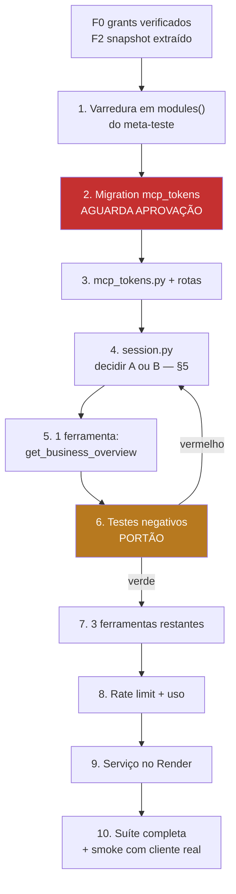

# MCP v0.1 — Plano de implementação

**Base:** `badcb97` (`origin/main`)
**Escopo:** somente leitura, 4 ferramentas.
**Pré-requisitos:** F0 (verificação de grants) e F2 (extração do snapshot) concluídas — ver `MUGO_EVOLUTION_ROADMAP.md`.
**Status:** nada implementado. Nenhum passo abaixo foi executado.

---

## 1. Inventário: o que se reusa e o que se cria

### 1.1 Arquivos existentes reusados **sem alteração**

**[F]** Verificados em `badcb97`.

| Arquivo | O que fornece | Por que não muda |
|---|---|---|
| `server/services/tenant.py` | `resolve_client_id` (`:56`), `require_client_read` (`:140`), `require_user_id` (`:19`) | É o ativo central. **[F]** `resolve_client_id` já recusa `client_id` não autorizado, que é o requisito mais difícil do briefing |
| `server/services/auth.py` | `get_user_id_from_bearer` (`:88`) | validação de JWT já correta |
| `server/services/intelligence_tools.py` | `ReadTools.discover()` (`:65`), `ReadTools.execute()` (`:102`) | **[F]** docstring `:1-4` declara o contrato como transporte-independente, para reuso por adaptador MCP |
| `server/services/request_performance.py` | `measured`, `transport_started/done` | instrumentação existente, reusada |
| `server/services/ig_supabase.py` | `sb_select`, `sb_insert`, `sb_update` | usado **apenas** pelo serviço de token, nunca pelas ferramentas |

**[F] `MAX_TOOL_CALLS = 1` (`intelligence_tools.py:18`) não é alterado.** Essa constante governa a rota `/ask`, que está em produção e coberta por teste. O MCP aplica o seu próprio teto, na sua própria camada.

### 1.2 Arquivos existentes **alterados**

| Arquivo | Alteração | Risco |
|---|---|---|
| `server/services/intelligence.py` | F2 já extraiu `collect_overview` / `compare`; aqui apenas se consome | nenhum novo |
| `render.yaml` | novo bloco de serviço web com `APP_ENV: production` | configuração |
| `server/requirements.txt` | `+ mcp` (SDK oficial) | 1 dependência nova |
| `server/tests/test_viewer_release_readiness.py` | `modules()` passa a varrer `routes/` em vez de lista literal | **[F]** corrige lacuna real: `sales_origin` ficou fora da lista (`:188-199`) |
| `supabase/migrations/` | nova migration `mcp_tokens` | **não aplicar sem aprovação** |

### 1.3 Arquivos novos

```
server/mcp/__init__.py
server/mcp/server.py              # app ASGI Streamable HTTP, registro de ferramentas
server/mcp/session.py             # token -> escopo; revalida membership a cada chamada
server/mcp/rate_limit.py          # cota persistida, nunca em memória
server/mcp/usage.py               # contabilidade por chamada
server/mcp/tools/__init__.py
server/mcp/tools/overview.py      # get_business_overview
server/mcp/tools/campaigns.py     # get_campaign_performance
server/mcp/tools/comparison.py    # compare_periods
server/mcp/tools/history.py       # get_analysis_history
server/run_mcp.py                 # entrypoint, espelha run_api.py

server/services/mcp_tokens.py     # emissão, hash, revogação, consulta
server/routes/mcp_tokens.py       # rotas do painel para gerir token

supabase/migrations/2026XXXX_0000XX_mcp_tokens.sql

server/tests/test_mcp_authorization.py     # negativos de acesso cruzado
server/tests/test_mcp_tools_contract.py    # schema, limites, evidência
server/tests/test_mcp_isolation.py         # testes estruturais de arquitetura
server/tests/test_mcp_tokens.py            # ciclo de vida do token
```

---

## 2. Passo 1 — Migration `mcp_tokens`

**Não aplicar sem aprovação explícita.**

```sql
-- MCP: tokens de acesso somente leitura, escopo de UMA empresa.
--
-- POR QUE UMA EMPRESA POR TOKEN
-- tenant.py:41-48 concede a quem tem papel agency_admin em QUALQUER empresa
-- o acesso a QUALQUER client_id existente. Na API isso é decisão de produto.
-- Num token entregue a um processo automatizado, seria uma chave mestra da
-- carteira. O escopo é gravado aqui e nunca derivado do papel.
--
-- Nasce fechada: RLS + revoke, no padrão das migrations 038 e 042. O token em
-- claro nunca é persistido — apenas o SHA-256.
-- Idempotente.

create table if not exists public.mcp_tokens (
  id uuid primary key default gen_random_uuid(),
  -- SHA-256 hex do token. O token em claro é exibido uma única vez, na emissão.
  token_hash text not null unique,
  -- Prefixo curto, só para o usuário reconhecer o token na lista. Não autentica.
  token_prefix text not null,

  client_id text not null references public.clients(id) on delete cascade,
  -- Usuário em nome de quem o token age. A membership DELE é revalidada a
  -- cada chamada: revogar a membership mata o token, sem precisar revogá-lo.
  user_id uuid not null references auth.users(id) on delete cascade,

  label text,
  -- Allowlist de ferramentas. Vazio = nenhuma. Nunca "todas".
  scopes jsonb not null default '[]'::jsonb,

  expires_at timestamptz not null,
  revoked_at timestamptz,
  revoked_by uuid references auth.users(id) on delete set null,
  last_used_at timestamptz,

  created_by uuid not null references auth.users(id) on delete restrict,
  created_at timestamptz not null default now()
);

create index if not exists mcp_tokens_client_idx
  on public.mcp_tokens(client_id, created_at desc);
create index if not exists mcp_tokens_active_idx
  on public.mcp_tokens(token_hash) where revoked_at is null;

-- Fechamento. O revoke é o que importa: o privilégio de tabela é verificado
-- ANTES da RLS, como a migration 042 documenta. RLS sozinha não bastaria.
alter table public.mcp_tokens enable row level security;
revoke all on public.mcp_tokens from anon, authenticated;
grant all on public.mcp_tokens to service_role;

notify pgrst, 'reload schema';
```

**Decisões de desenho, e o motivo de cada uma:**

| Decisão | Motivo |
|---|---|
| `token_hash` único, token em claro nunca gravado | vazamento da tabela não concede acesso |
| `client_id` **not null**, uma empresa | **[F]** anula o alcance global de `agency_admin` |
| `user_id` com membership revalidada a cada chamada | revogação de membership tem efeito imediato, sem gerir revogação de token |
| `scopes` default `'[]'` | falha fechado: token sem escopo não faz nada |
| `expires_at` **not null** | não existe token eterno |
| `created_by` com `on delete restrict` | preserva quem emitiu |
| RLS **e** revoke | **[F]** padrão das 038/042 |

---

## 3. Passo 2 — `server/services/mcp_tokens.py`

Responsabilidades, e só estas:

```python
async def issue_token(client_id, user_id, label, scopes, ttl_days) -> dict
# Gera 32 bytes de secrets.token_urlsafe, grava SHA-256, devolve o claro UMA vez.
# client_id JÁ resolvido pelo guard — nunca o solicitado pelo chamador.

async def resolve_token(raw_token) -> dict | None
# Hash -> linha. Recusa expirado ou revogado. NÃO valida membership:
# isso é da sessão (passo 4), porque é uma preocupação distinta.

async def list_tokens(client_id) -> list[dict]
# Nunca devolve hash nem token. Só prefixo, label, escopos, datas.

async def revoke_token(client_id, token_id, revoked_by) -> dict
# Filtra por client_id E token_id, e reverifica a linha devolvida.

async def touch_last_used(token_id) -> None
# Fire-and-forget. Nunca bloqueia nem falha a chamada da ferramenta.
```

**[F] Padrão obrigatório, já estabelecido na casa** (`intelligence_conversations.py:21-22`, `intelligence_tools.py:73` e `:149`): filtrar por `client_id` na consulta **e** reverificar as linhas devolvidas.

```python
def _owned(rows, client_id):
    return [row for row in rows if row.get("client_id") == client_id]
```

Protege contra filtro malformado, que é o modo de falha real.

---

## 4. Passo 3 — Rotas do painel

`server/routes/mcp_tokens.py`:

| Método | Rota | Guard | Razão do guard |
|---|---|---|---|
| `GET` | `/api/clients/{client_id}/mcp-tokens` | `require_client_read` | listar é leitura |
| `POST` | `/api/clients/{client_id}/mcp-tokens` | **`require_client_manage`** | emitir credencial é mutação sensível |
| `DELETE` | `/api/clients/{client_id}/mcp-tokens/{token_id}` | **`require_client_manage`** | revogar é mutação |

**[F] Padrão a copiar literalmente de `sales_origin.py:13-29`** — é o melhor exemplar do repositório:

```python
@router.post("")
async def create_mcp_token(
    client_id: str,
    payload: Dict[str, Any],
    authorization: str | None = Header(default=None),
):
    # Rebind: o escopo é o RESOLVIDO, nunca o do path.
    cid = await require_client_manage(client_id, authorization)
    user_id = await require_user_id(authorization)
    try:
        return await issue_token(cid, user_id, ...)
    except RuntimeError as exc:
        print(f"[mcp_tokens] client_id={cid} status=error error_type={exc.__class__.__name__}")
        raise HTTPException(503, "Não foi possível emitir o token.") from None
```

Três detalhes que não são estilo:

- **`cid = await require_...(client_id, ...)`** — o `client_id` do path é tratado como pedido; o escopo é o retorno do guard.
- **`from None`** — impede que o traceback interno vaze na resposta.
- **`error_type=exc.__class__.__name__`** — loga o **tipo**, nunca a mensagem, que pode conter dado.

**[F]** Como estas duas rotas são de mutação, elas entram automaticamente no meta-teste `test_no_mutation_route_lacks_a_role_guard` — **desde que** `modules()` passe a varrer `routes/`. Hoje é lista literal (`:188-199`) e não cobriria o módulo novo. **Esta correção vem antes de criar as rotas**, não depois.

---

## 5. Passo 4 — `server/mcp/session.py`

O ponto onde todo risco de autorização se concentra.

```python
async def authorize(raw_token: str, tool_name: str) -> Session:
    """Token -> escopo verificado. Única porta de entrada das ferramentas."""
    row = await resolve_token(raw_token)
    if not row:
        raise McpError("MCP_TOKEN_INVALID")

    if tool_name not in (row.get("scopes") or []):
        raise McpError("MCP_TOKEN_SCOPE_DENIED")

    client_id = row["client_id"]

    # O passo que não pode ser removido: a membership pode ter sido revogada
    # DEPOIS da emissão. Sem isto, um token de 30 dias sobreviveria ao
    # desligamento de um funcionário.
    try:
        resolved = await require_client_read(client_id, _service_authorization(row["user_id"]))
    except HTTPException:
        raise McpError("MCP_TOKEN_REVOKED")

    if resolved != client_id:
        # Divergência não deve acontecer. Se acontecer, falha fechado.
        raise McpError("MCP_TOKEN_REVOKED")

    return Session(client_id=resolved, user_id=row["user_id"], token_id=row["id"])
```

**`Session` é imutável e não expõe `client_id` como parâmetro a nenhuma ferramenta.** As ferramentas recebem a `Session`; o `client_id` chega por dentro dela.

### Ponto aberto a resolver na implementação

**[F]** `require_client_read` espera um header `Authorization` com JWT do Supabase, e **[F]** `auth.py:88-125` valida esse JWT por **chamada de rede** a `/auth/v1/user`. O MCP tem `user_id`, não um JWT do usuário.

Dois caminhos, e o segundo é o recomendado:

| Caminho | Prós | Contras |
|---|---|---|
| **A.** Guardar um refresh token do Supabase junto do token MCP | reusa `require_client_read` sem tocá-lo | guarda credencial de usuário — amplia o que um vazamento da tabela custa |
| **B.** Extrair de `tenant.py` uma função `resolve_client_id_for_user(user_id, client_id)` que parta de `user_id` já verificado | **não guarda credencial**; elimina 1 roundtrip de rede por chamada | altera `tenant.py`, que é o ativo mais sensível |

**Recomendação: B**, por dois motivos.

1. **[F]** A lógica necessária já existe isolada e é exatamente isso: `sb_get_client_id_for_user(user_id, requested_client_id)` (`ig_supabase.py:382`). `resolve_client_id` basicamente valida o JWT e delega para ela. A extração expõe o que já está lá, sem duplicar regra.
2. Elimina o gargalo de latência: **[F]** sem isso, cada chamada de ferramenta paga um roundtrip a `/auth/v1/user` (memoizado apenas **dentro** de uma requisição — `request_performance.py:1`). Um agente com 10 chamadas pagaria 10 validações.

**Condição para B:** `resolve_client_id` passa a chamar a função extraída, e **nenhum teste existente de tenant é alterado**. **[F]** Rede de segurança: `test_tenant_isolation` e `test_final_viewer_tenant_matrix`. Se qualquer um exigir alteração, a extração está errada — reverter e usar A.

---

## 6. Passo 5 — Ferramentas

### Contrato comum

```python
TOOLS: dict[str, Tool] = {}   # registro; a varredura dos testes parte daqui

def tool(name: str, schema: dict, rate: int):
    def register(fn):
        # Falha na importação, não em produção: nenhuma ferramenta pode
        # declarar client_id. Esta é a invariante central do desenho.
        assert "client_id" not in schema.get("properties", {}), \
            f"{name}: client_id nunca é parâmetro de ferramenta"
        TOOLS[name] = Tool(name=name, schema=schema, rate=rate, fn=fn)
        return fn
    return register
```

O `assert` no decorador é deliberado: torna a invariante **impossível de violar por descuido**. Um PR que adicione `client_id` a um schema não compila.

### Período: validação única e compartilhada

```python
MAX_WINDOW_DAYS = 366

def validate_period(start: str, end: str) -> tuple[date, date]:
    s, e = date.fromisoformat(start), date.fromisoformat(end)
    if e < s or (e - s).days > MAX_WINDOW_DAYS or e > date.today():
        raise McpError("MCP_PERIOD_INVALID")
    return s, e
```

**[F]** Mesmo limite de `sales_origin.py:20-21` (`366` dias). Coerência deliberada, não coincidência.

### 6.1 `get_business_overview`

```python
@tool("get_business_overview", schema={
    "type": "object", "additionalProperties": False,
    "properties": {"period_start": {"type": "string", "format": "date"},
                   "period_end":   {"type": "string", "format": "date"}},
    "required": ["period_start", "period_end"],
}, rate=30)
async def get_business_overview(session: Session, period_start: str, period_end: str) -> dict:
    s, e = validate_period(period_start, period_end)
    return await collect_overview(session.client_id, s, e)   # extraído em F2
```

**`additionalProperties: False` é obrigatório em toda ferramenta.** Sem isso, o cliente pode enviar chaves extras — **[F]** exatamente o que `intelligence_tools.py:46-48` já recusa, exigindo que o conjunto de chaves seja **igual** a `{"name"}`.

### 6.2 `get_campaign_performance`

Envelopa `ReadTools` sem alterá-la:

```python
@tool("get_campaign_performance", schema={...}, rate=30)
async def get_campaign_performance(session, period_start, period_end, limit=3):
    s, e = validate_period(period_start, period_end)
    tools = ReadTools(session.client_id, {"start": period_start, "end": period_end},
                      campaign_reader=read_campaign_performance)
    await tools.discover()                     # monta allowed_accounts das conexões
    return await tools.execute({"name": "read_campaigns"})
```

**[F]** `discover()` (`:65-99`) lê as conexões persistidas e monta `allowed_accounts` como `frozenset`, repassado como allowlist (`:110-112`). O modelo não escolhe conta de anúncio. **[F]** `:129` remove `ad_account_id` e `campaign_id` da saída. Nada disso precisa ser reimplementado — só não pode ser contornado.

### 6.3 `compare_periods`

A ferramenta de maior risco de alucinação, e por isso a de regra mais rígida:

```python
@tool("compare_periods", schema={...}, rate=20)
async def compare_periods(session, period_start, period_end,
                          baseline_start=None, baseline_end=None):
    s, e = validate_period(period_start, period_end)
    if baseline_start and baseline_end:
        bs, be = validate_period(baseline_start, baseline_end)
        if bs <= e and s <= be:
            raise McpError("MCP_BASELINE_INVALID")   # sobreposição
    else:
        span = (e - s).days + 1
        be, bs = s - timedelta(days=1), s - timedelta(days=span)

    result = await compare(session.client_id, (s, e), (bs, be))   # extraído em F2

    # Regra dura: cobertura incompleta em qualquer lado => sem número.
    for metric in result["metrics"]:
        if metric.get("status") != "confirmed" or metric.get("baseline_status") != "confirmed":
            metric["variation_percent"] = None
            metric["comparable"] = False
            result.setdefault("limitations", []).append(
                f"{metric['id']}: cobertura incompleta em um dos períodos; variação não calculada."
            )
        else:
            metric["comparable"] = True
    return result
```

**Por que `null` e não um número com ressalva.** Um modelo que recebe `variation_percent: 47.3` acompanhado de um aviso textual vai reportar 47,3%. Um modelo que recebe `null` não tem o que reportar. A disciplina tem de estar no **dado**, não no texto adjacente.

**[F]** É a mesma escolha que o motor já faz: `status: "unavailable"` com `value: None`, em vez de devolver zero (`intelligence_tools.py:163`). E é a mesma regra que as instruções do modelo já enunciam (`intelligence.py:380`): *"não compare o dia incompleto com um dia completo"* — aqui ela deixa de depender da obediência do modelo.

### 6.4 `get_analysis_history`

```python
@tool("get_analysis_history", schema={...}, rate=60)
async def get_analysis_history(session, limit=10):
    data = await analysis_history(session.client_id, limit=min(max(int(limit), 1), 20))
    # Metadados e resumo. Nunca o jsonb inteiro: é grande e é conteúdo gerado,
    # que ao voltar ao modelo se torna entrada não confiável.
    return {"items": [{
        "id": it["id"], "period_start": it["period_start"], "period_end": it["period_end"],
        "status": it["status"], "created_at": it["created_at"],
        "sources": it.get("sources") or [], "data_quality": it.get("data_quality") or {},
        "untrusted_text": {"summary": _summary(it)},   # marcado como dado
    } for it in data.get("items", [])]}
```

**A chave `untrusted_text` é intencional.** O conteúdo de uma análise anterior foi escrito por um modelo a partir de dados externos (nomes de campanha, por exemplo). Ao retornar ao contexto, é superfície de injeção. Marcar sinaliza ao cliente MCP que aquilo é dado, nunca instrução.

---

## 7. Passo 6 — Rate limit persistido

```python
async def consume(token_id: str, tool_name: str, limit: int) -> None:
    """Janela de 1 hora, contada no banco."""
    window = datetime.now(timezone.utc).replace(minute=0, second=0, microsecond=0)
    used = await _increment(token_id, tool_name, window)
    if used > limit:
        raise McpError("MCP_RATE_LIMITED")
```

**No banco, não em memória.** **[F]** O precedente está no próprio código e é explícito: o cooldown de geração foi feito lido do banco para *"valer entre instâncias do Render, sem depender de estado em memória"* (`intelligence.py:2424-2426`), enquanto o lock `asyncio` (`:2431`) cobre só *"cliques concorrentes no mesmo worker"*. Com múltiplas instâncias, limite em memória é limite multiplicado pelo número de instâncias.

Dois tetos: por token (100/h somadas) e por ferramenta (§6).

---

## 8. Passo 7 — Contabilidade de uso

```python
async def record(session, tool_name, duration_ms, status,
                 error_code=None, rows_read=None, payload_bytes=None) -> None:
    ...
```

Registra `request_id, client_id, user_id, token_id, tool_name, duration_ms, status, error_code, rows_read, payload_bytes`.

**Números, nunca conteúdo.** Não registrar argumentos, resultado, nome de campanha ou token.

**[F]** Regra já praticada: `intelligence.py:2185-2190` loga só o código do erro, com o comentário *"Só o código: o valor da variável nunca entra no log"*; `sales_origin.py:27` loga `error_type`, não a mensagem.

**[F] Por que isto entra na v0.1 e não depois:** a auditoria mediu zero instrumentação de custo de IA no sistema atual. Nascer sem ela é repetir a dívida que o roadmap está pagando na fase 1.

---

## 9. Passo 8 — Serviço no Render

```yaml
  - type: web
    name: mugo-dados-mcp
    runtime: python
    buildCommand: pip install -r server/requirements.txt
    startCommand: python run_mcp.py
    envVars:
      - key: PYTHON_VERSION
        value: 3.13.2
      # OBRIGATÓRIO. Sem esta linha, os bypasses de autenticação de
      # tenant.py:28-38 e auth.py:128-137 ficam habilitáveis por flag,
      # porque ambos só bloqueiam quando APP_ENV e production ou prod.
      - key: APP_ENV
        value: production
      - key: SUPABASE_URL
        sync: false
      - key: SUPABASE_SERVICE_ROLE_KEY
        sync: false
      - key: SUPABASE_ANON_KEY
        sync: false
```

**[F]** A linha `APP_ENV` não é cerimônia: `render.yaml:17-18` define essa variável **apenas** no serviço web atual, e os 13 crons não a definem. Um serviço novo sem ela herda o lado inseguro do default.

**Correção estrutural recomendada em F1 (tarefa 1.5):** inverter o default no código — ausência de `APP_ENV` significa produção, e liberar bypass exige `APP_ENV=development` explícito. Isso elimina a classe de erro em vez de remediar uma instância.

---

## 10. Testes

Nenhum destes existe. **Nada abaixo foi executado.**

### `test_mcp_authorization.py` — negativos, os que mais importam

| Teste | Afirma |
|---|---|
| `test_token_of_tenant_a_never_returns_tenant_b_data` | token de A, dado de B → vazio ou erro. **Nunca** dado de B |
| `test_revoked_membership_invalidates_live_token` | membership removida → `MCP_TOKEN_REVOKED` na chamada seguinte |
| `test_agency_admin_token_is_scoped_to_one_company` | **[F]** `agency_admin` alcança qualquer empresa na API (`tenant.py:41-48`); o token **não** |
| `test_expired_token_is_refused` | `expires_at` respeitado |
| `test_revoked_token_is_refused` | `revoked_at` respeitado |
| `test_token_outside_scope_is_refused` | ferramenta fora de `scopes` → `MCP_TOKEN_SCOPE_DENIED` |
| `test_empty_scopes_grants_nothing` | falha fechado |
| `test_token_is_never_stored_in_clear` | tabela contém só o hash |

### `test_mcp_isolation.py` — estruturais

| Teste | Afirma |
|---|---|
| `test_mcp_tools_do_not_import_ig_supabase` | AST sobre `server/mcp/tools/`: nenhum import da camada de dados |
| `test_every_registered_tool_requires_session` | toda entrada de `TOOLS` recebe `Session` |
| `test_no_tool_schema_accepts_client_id` | varredura de `TOOLS`; complementa o `assert` do decorador |
| `test_no_write_tool_is_registered` | v0.1 não registra escrita |
| `test_no_tool_calls_parameter_trusted_rpc` | **[F]** nenhuma ferramenta chama RPC cujo acesso dependa de argumento — regra derivada de `delete_platform_company`, documentada na migration 042 |

**[F]** Estes testes seguem o padrão de `test_viewer_release_readiness.py:200-218`, que varre o fonte das rotas. **E corrigem a sua falha de mecanismo:** o original enumera módulos à mão (`:188-199`) e deixou `sales_origin` fora. Os testes MCP **descobrem** pelo registro `TOOLS`, nunca por lista literal.

### `test_mcp_tools_contract.py`

| Teste | Afirma |
|---|---|
| `test_period_window_is_bounded` | janela > 366 dias → `MCP_PERIOD_INVALID` |
| `test_future_end_date_is_refused` | `end > hoje` recusado |
| `test_overlapping_baseline_is_refused` | `MCP_BASELINE_INVALID` |
| `test_partial_coverage_yields_null_variation` | lado parcial → `variation_percent is None` e `comparable is False` |
| `test_metric_always_carries_status_and_window` | nenhuma métrica sem `status` e janela |
| `test_campaign_ids_are_stripped` | sem `ad_account_id` / `campaign_id` na saída |
| `test_errors_never_leak_internals` | nenhuma mensagem com SQL, nome de tabela, traceback ou dado de cliente |
| `test_additional_properties_are_refused` | chave extra recusada |

### `test_mcp_tokens.py`

Emissão sob `require_client_manage`; `viewer` recusado; listagem sem hash; revogação idempotente; `touch_last_used` não falha a chamada.

### Não regressão — a condição de aceite mais importante

| Teste | Afirma |
|---|---|
| suíte completa | **1682 testes, exatamente as mesmas 3 falhas conhecidas, nenhuma nova** |
| `test_ask_route_still_limits_to_one_tool_call` | **[F]** `MAX_TOOL_CALLS` da rota `/ask` continua 1 |
| `npm test` | 748/748 (baseline medida) |

**Se F1 já tiver zerado as 3 falhas, o critério passa a 0 falhas.** O que não se aceita, em nenhum cenário, é **falha nova**.

---

## 11. Ordem de execução



**Passo 1 vem primeiro** porque as rotas de token são mutações: sem a varredura, elas entram sem verificação de guard. Corrigir o mecanismo antes de criar o que ele deveria cobrir.

**Passo 6 é portão, não etapa.** Uma ferramenta, com os negativos de acesso cruzado passando, antes das outras três. Se o isolamento falha com uma ferramenta, falha com quatro — e o custo de descobrir é 4× maior. As outras três são repetição de um padrão já provado.

---

## 12. Pontos que exigem decisão antes de codificar

| # | Decisão | Recomendação |
|---|---|---|
| 1 | §5: caminho **A** (guardar refresh token) ou **B** (extrair `resolve_client_id_for_user`) | **B** — não guarda credencial e remove 1 roundtrip por chamada. Reverter para A se algum teste de tenant exigir alteração |
| 2 | Quem pode emitir token: `client_admin` ou só `agency_admin` | **`require_client_manage`** (inclui ambos). Restringir depois é fácil; ampliar é mudança de postura |
| 3 | TTL padrão | **30 dias**, máximo 90 |
| 4 | Versão do SDK `mcp` | **confirmar na implementação.** O protocolo evoluiu rápido; não fixar versão num plano |
| 5 | Domínio | `mcp.dados.mugoagencia.com.br`, coerente com `api.dados.mugoagencia.com.br` (**[F]** `render.yaml:20`) |

---

## 13. Esforço

**[S]** Estimativas. Dias de uma pessoa.

| Passo | Esforço |
|---|---|
| 1. Varredura no meta-teste | 0,5 |
| 2. Migration | 0,5 |
| 3. Serviço + rotas de token | 1,5 |
| 4. `session.py` + decisão §5 | 1,5 |
| 5. Primeira ferramenta | 1,0 |
| 6. Testes negativos (portão) | 1,5 |
| 7. Três ferramentas restantes | 2,0 |
| 8. Rate limit + uso | 1,0 |
| 9. Render + deploy | 0,5 |
| 10. Suíte + smoke | 0,5 |
| **Total** | **≈10 dias** |

Não inclui F0 (1–2 d) nem F2 (4 d), que são pré-requisitos.

---

## 14. O que esta v0.1 deliberadamente **não** entrega

| Não entrega | Razão |
|---|---|
| Qualquer ferramenta de escrita | separação leitura/execução exigida pelo briefing; é também a defesa mais forte contra injeção, e é gratuita |
| OAuth / Dynamic Client Registration | população de clientes conhecida; entra quando houver cliente externo |
| Ferramentas de memória estratégica | dependem de F4 |
| Detecção de anomalia | F5, e como leitura que propõe, nunca executa |
| Alteração de `MAX_TOOL_CALLS` na rota `/ask` | **[F]** está em produção e coberta por teste; o MCP tem teto próprio |
| Acesso direto ao Supabase | **[F]** `service_role` ignora RLS; o guard aplicacional é a única fronteira deste caminho, e atravessá-lo é obrigatório |
